# Отчёт о лабораторной работе №6

**Система контроля версий**

Студент группы №4517 А.С. Андрейкин

**Цель работы:** изучить базовые возможности системы управления версиями, получить опыт работы с Git, а также с локальным и удалённым репозиторием.

## 1. Аккаунт GitHub и копирование репозитория

Для выполнения работы использовался личный аккаунт на сайте GitHub `KvodratnoeSozdanie`, профиль которого представлен на рисунке 1.


Рисунок 1 – Профиль на сайте GitHub

Далее была создана копия (fork) репозитория `Kurtyanik/LR6` в личное хранилище. Название репозитория было оставлено прежним, а копироваться была выбрана только ветка `master`, что видно на рисунке 2.


Рисунок 2 – Создание копии репозитория

В результате в личном хранилище появился репозиторий `KvodratnoeSozdanie/LR6`, содержащий файлы `README.md` и `mergefile.txt` и три коммита (рисунок 3).


Рисунок 3 – Репозиторий после создания копии

## 2. Установка и настройка Git

Git был установлен на компьютер, после чего все команды выполнялись в консоли UCRT64. Для настройки клиента были введены имя пользователя в формате "группа фамилия инициалы" и адрес электронной почты (рисунок 4). Параметры задавались с ключом `--global`, поэтому они будут использоваться для всех репозиториев на данном компьютере.


Рисунок 4 – Настройка имени пользователя и email

## 3. Клонирование репозитория

Личный удалённый репозиторий был клонирован на компьютер командой `git clone` (рисунок 5). В результате в рабочей папке была создана папка `LR6` с локальной копией репозитория.

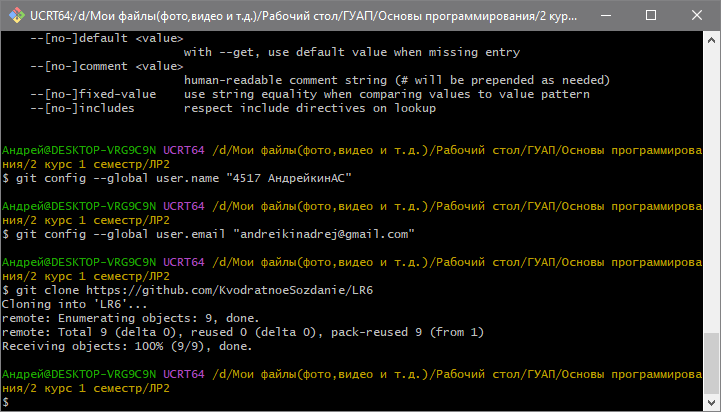

Рисунок 5 – Клонирование репозитория

## 4. Добавление файла через интерфейс GitHub

Через веб-интерфейс GitHub в ветку `master` был добавлен файл `Отчёт.txt` с текстом «Начало отчёта». При фиксации изменений было указано сообщение "Добавление отчёта" и расширенное описание (рисунок 6).

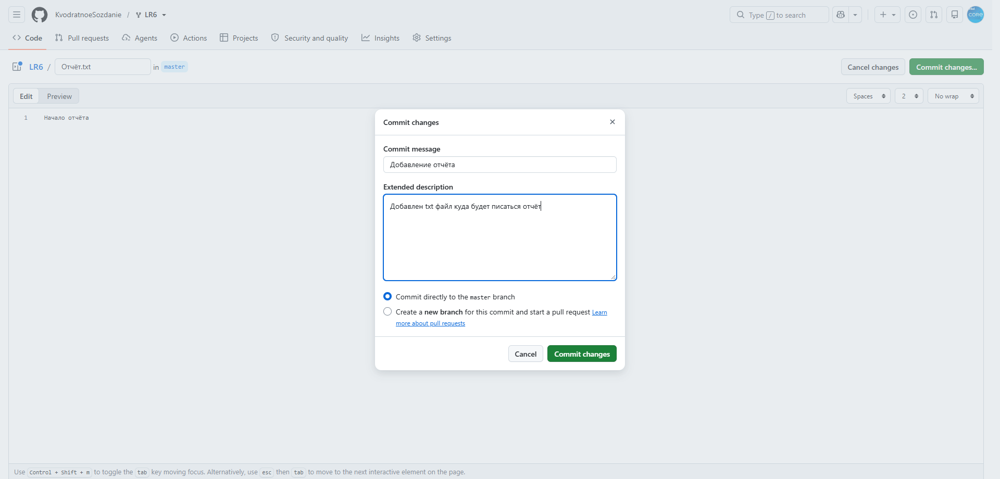

Рисунок 6 – Добавление файла через интерфейс GitHub 

После этого в репозитории на GitHub стало 4 коммита, а в списке файлов появился новый файл (рисунок 7). Локальный репозиторий при этом об изменениях ещё не знал.

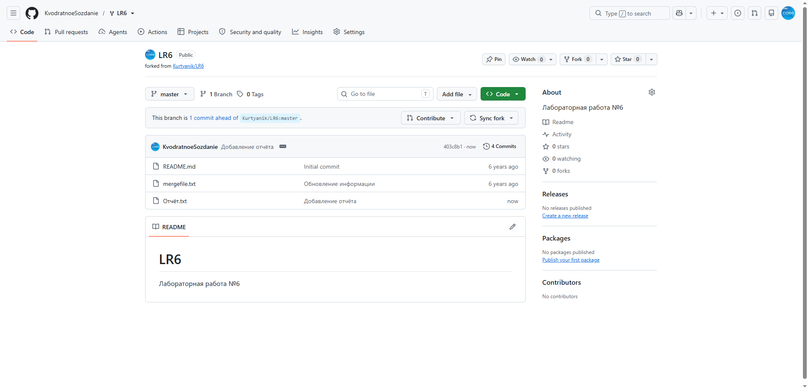

Рисунок 7 – Репозиторий на GitHub после добавления файла

Чтобы подтянуть изменения, в папке `LR6` была выполнена команда `git pull` (рисунок 8). Слияние прошло в режиме fast-forward: локальная ветка `master` была обновлена с коммита `921f53b` до `403c8b1`, а новый файл был создан. Имя файла в выводе команды отображается в виде восьмеричных кодов, ибо Git по умолчанию экранирует символы, не входящие в ASCII. На работу с файлом это никак не влияет.

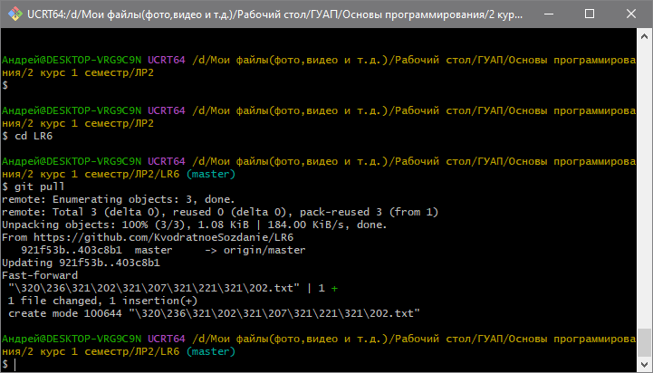

Рисунок 8 – Получение изменений из удалённого репозитория

Появление файла `Отчёт.txt` в локальной папке подтверждается на рисунке 9.

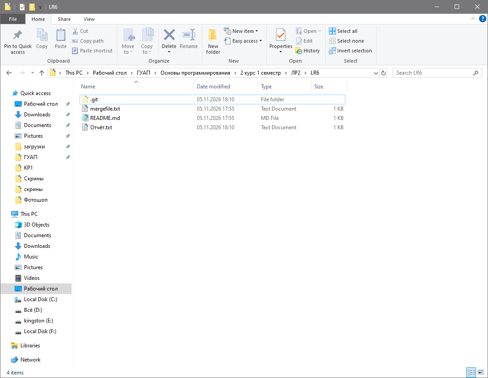

Рисунок 9 – Содержимое локальной папки репозитория

## 5. Работа с ветками и фиксация изменений

Дальнейшая работа велась локально. Для подготовки конфликта слияния была создана новая ветка `additional` и выполнен переход в неё командой `git checkout -b additional` (рисунок 10).

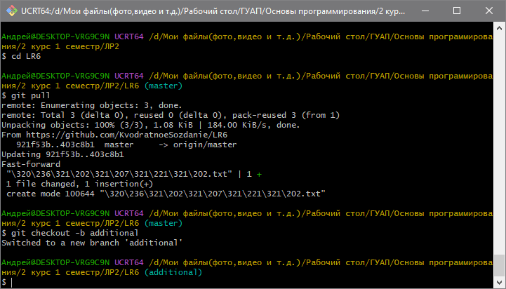

Рисунок 10 – Создание ветки additional

В этой ветке содержимое файла `mergefile.txt` было заменено на строку "Тут теперь новая информация" (рисунок 11).


Рисунок 11 – Файл mergefile.txt в ветке additional

Изменение было добавлено в индекс и зафиксировано коммитом `1edd12f` с комментарием «Поменял информацию в mergefile.txt». По данным Git, в файле была 1 вставка и 5 удалений (рисунок 12).

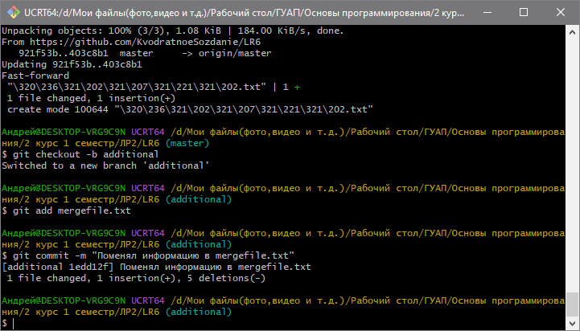

Рисунок 12 – Коммит в ветке additional

Затем был выполнен возврат в ветку `master`, где тот же файл был изменён иначе: теперь он содержал строку «Тут другая новая информация» (рисунок 13).

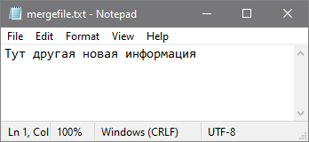

Рисунок 13 – Файл mergefile.txt в ветке master

Это изменение также было зафиксировано, коммит `4a513fd` получил комментарий "Добавил конфликт в mergefile.txt" (рисунок 14). Так как в обеих ветках была изменена одна и та же строка одного файла, при слиянии должен возникнуть конфликт.

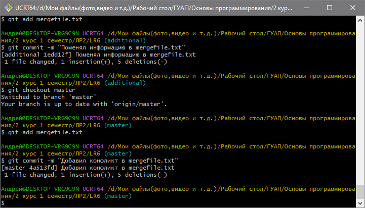

Рисунок 14 – Коммит в ветке master

## 6. История операций и просмотр изменений

Историю каждой из веток можно получить командами `git log --oneline` и `git log --oneline additional`. Для наглядного просмотра расхождения веток была использована команда с параметрами `--graph --all` (рисунок 15). Из графа видно, что обе ветки отходят от коммита `403c8b1` "Добавление отчёта": в `master` добавлен коммит `4a513fd`, а в `additional` – коммит `1edd12f`.

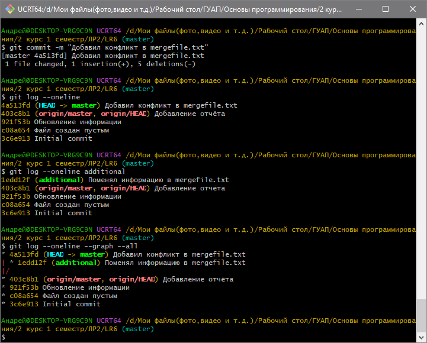

Рисунок 15 – История операций

Последние изменения были просмотрены командой `git diff master..additional` (рисунок 16). Она показывает, что в `master` строка имеет вид "Тут другая новая информация", а в `additional` – "Тут теперь новая информация". Сообщение `No newline at end of file` означает, что в конце файла отсутствует символ переноса строки.

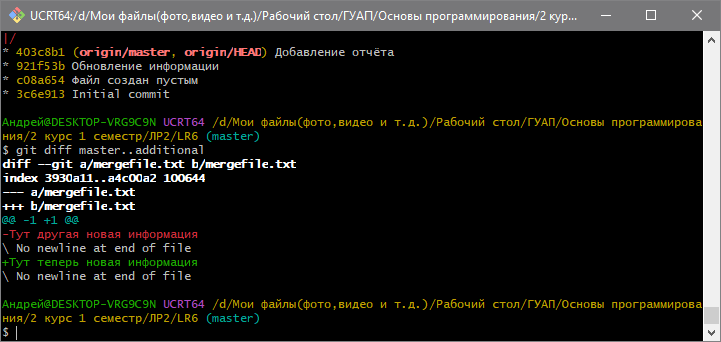

Рисунок 16 – Различия между ветками master и additional

## 7. Слияние веток и разрешение конфликта

Находясь в ветке `master`, была выполнена команда `git merge additional`. Как и ожидалось, Git не смог объединить изменения автоматически и сообщил о конфликте в файле `mergefile.txt`, а в приглашении командной строки появилась пометка `MERGING` (рисунок 17).

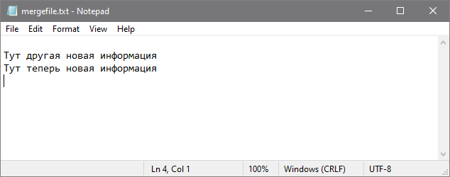

Рисунок 17 – Слияние веток с конфликтом

Конфликт был разрешён вручную в текстовом редакторе: в итоговом файле были оставлены обе строки (рисунок 18).

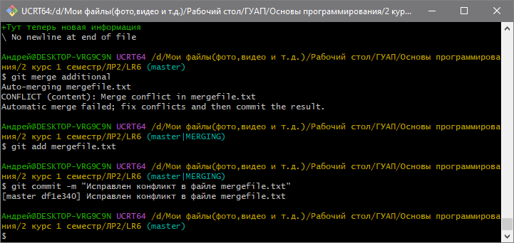

Рисунок 18 – Файл mergefile.txt после разрешения конфликта

После этого файл был добавлен в индекс командой `git add`, а слияние завершено коммитом `df1e340` с комментарием "Исправлен конфликт в файле mergefile.txt" (рисунок 17).

## 8. Удаление побочной ветки

После успешного слияния побочная ветка была удалена командой `git branch -d additional` (рисунок 19). Ключ `-d` удаляет только те ветки, которые уже были слиты, поэтому потеря данных исключена. Git сообщил, что ветка указывала на коммит `1edd12f`.

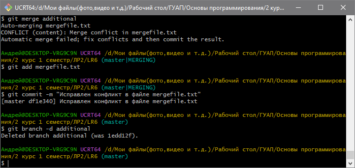

Рисунок 19 – Удаление ветки additional

## 9. Откат коммита

Для отката была использована команда `git reset --hard HEAD~1`, которая перемещает ветку на один коммит назад и приводит рабочие файлы в соответствующее состояние (рисунок 20). В результате был отменён коммит слияния `df1e340`, и `master` вернулась на коммит `4a513fd`. Сами коммиты при этом не пропадают окончательно и остаются доступны по хэшу, например через `git reflog`.

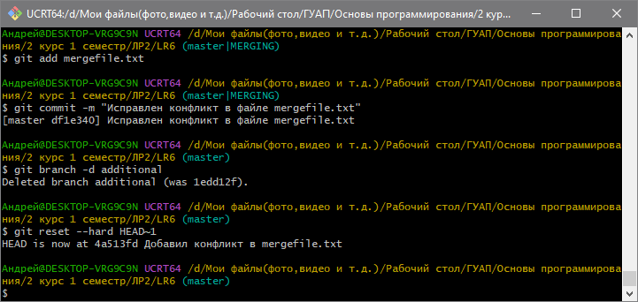

Рисунок 20 – Откат коммита

## 10. Ветка для отчёта

Для оформления отчёта была создана отдельная ветка `report`, в которой в файле `README.md` велась работа над отчётом. Скриншоты были размещены в отдельной папке `screenshots`. По мере написания отчёта выполнялись коммиты с комментариями.

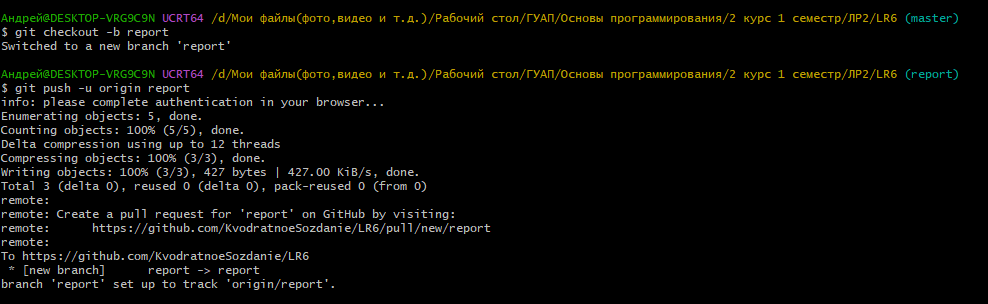

Рисунок 21 – Создание ветки для отчёта

## 11. Форматированная история операций

Историю коммитов в формате "сокращённый хэш + дата + имя автора + комментарий" можно получить командой:

```
git log --pretty=format:"%h %ad %an %s" --date=short
```

Результат выполнения команды представлен на рисунке 22 и ниже в виде текста.

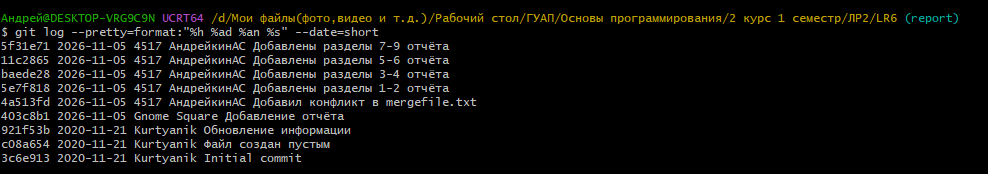

Рисунок 22 – История операций в форматированном виде

## 12. Отправка изменений в удалённый репозиторий

Локальная ветка `report` была отправлена в удалённый репозиторий командой `git push -u origin report` (рисунок 23). Так как такой ветки на GitHub ещё не было, она была создана автоматически, а ключ `-u` связал её с локальной веткой. Git при этом предложил создать pull request. Повторный вызов команды вернул сообщение `Everything up-to-date`, что означает отсутствие неотправленных изменений.

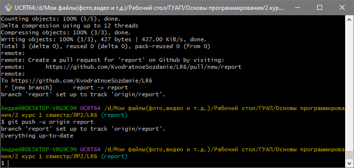

Рисунок 23 – Отправка ветки report на GitHub