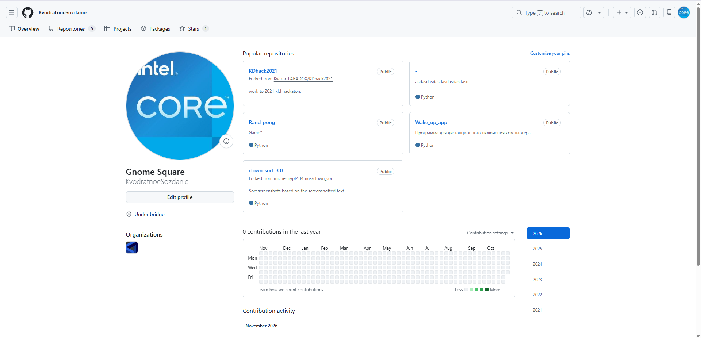
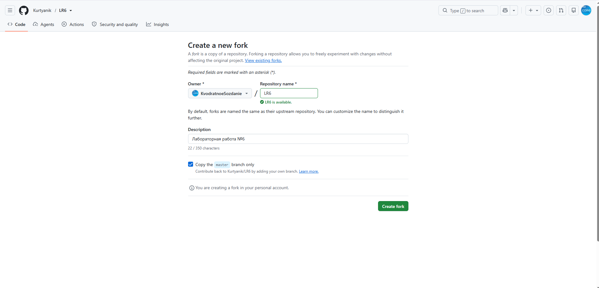
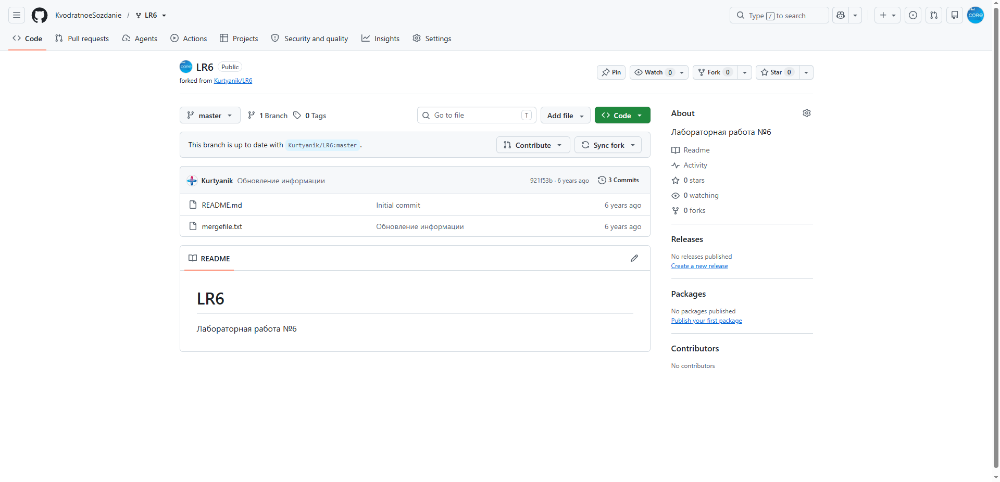
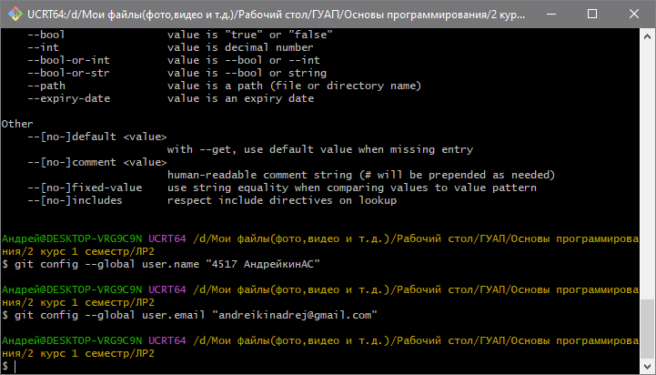

# Отчёт о лабораторной работе №6

**Система контроля версий**

Студент группы №4517 А.С. Андрейкин

**Цель работы:** изучить базовые возможности системы управления версиями, получить опыт работы с Git, а также с локальным и удалённым репозиторием.

## 1. Аккаунт GitHub и копирование репозитория

Для выполнения работы использовался личный аккаунт на сайте GitHub `KvodratnoeSozdanie`, профиль которого представлен на рисунке 1.

Рисунок 1 – Профиль на сайте GitHub

Далее была создана копия (fork) репозитория `Kurtyanik/LR6` в личное хранилище. Название репозитория было оставлено прежним, а копироваться была выбрана только ветка `master`, что видно на рисунке 2.

Рисунок 2 – Создание копии репозитория

В результате в личном хранилище появился репозиторий `KvodratnoeSozdanie/LR6`, содержащий файлы `README.md` и `mergefile.txt` и три коммита (рисунок 3).

Рисунок 3 – Репозиторий после создания копии

## 2. Установка и настройка Git

Git был установлен на компьютер, после чего все команды выполнялись в консоли UCRT64. Для настройки клиента были введены имя пользователя в формате «группа фамилия инициалы» и адрес электронной почты (рисунок 4). Параметры задавались с ключом `--global`, поэтому они будут использоваться для всех репозиториев на данном компьютере.

Рисунок 4 – Настройка имени пользователя и email